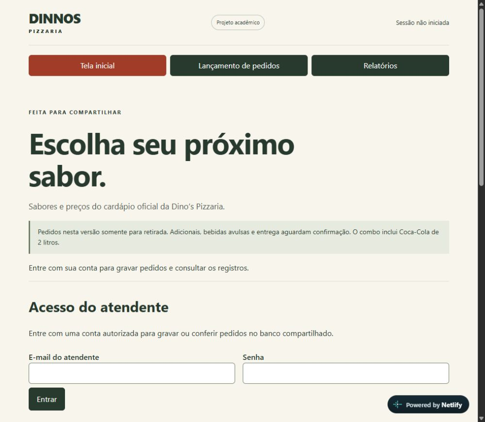
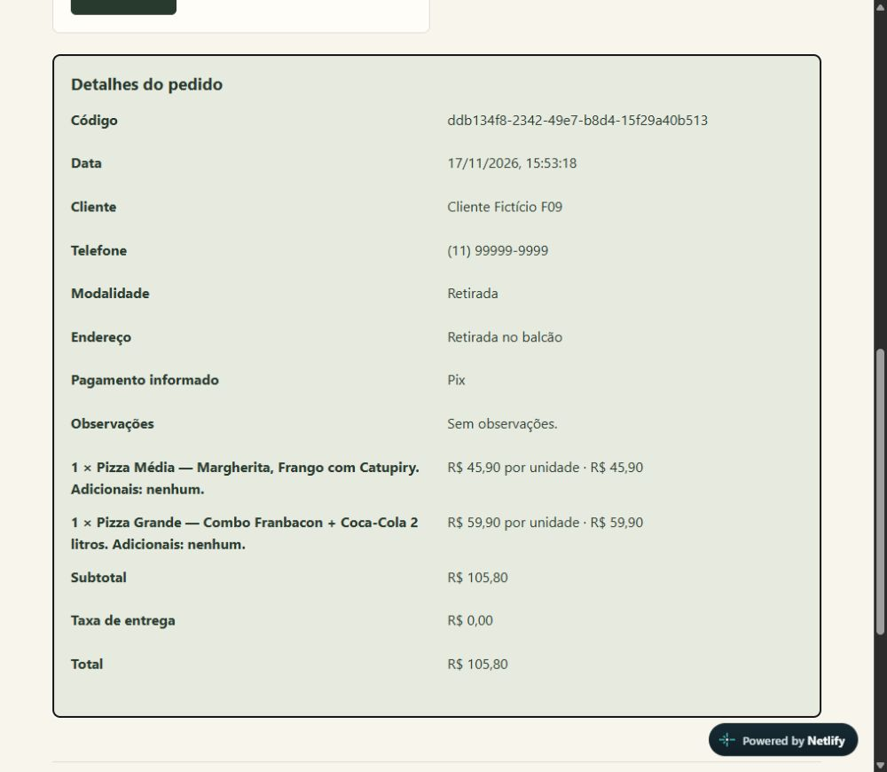

# Atualização do cardápio e das telas

Complemento ao relatório da F07, em 17 de novembro de 2026. O PDF acadêmico
preserva as verificações e telas da etapa anterior; este documento registra a
versão posterior com dados do cardápio oficial fornecido pelo autor.

## Cardápio confirmado

O catálogo possui cinco pizzas salgadas em média e grande, Romeu e Julieta apenas
grande e o combo Franbacon grande acompanhado de Coca-Cola de 2 litros. Os valores
e ingredientes estão transcritos em
[cardápio oficial](../harness/main/specs/cardapio-oficial.md).
São permitidos até dois sabores por pizza, pelo preço do mais caro. O combo é um
conjunto fechado, com preço completo de R$ 59,90. Os produtos e preços atuais
foram fornecidos pelo autor; os clientes e pedidos de verificação são fictícios.

Adicionais, bebidas avulsas e entrega foram excluídos da oferta nesta atualização
por solicitação do autor, pois seus detalhes ainda precisam de confirmação.
O site aceita somente retirada. Os valores históricos não foram recalculados.

## Organização das telas

- Tela inicial: apresentação, login e cardápio.
- Lançamento de pedidos: dados, montagem, revisão e confirmação de gravação.
- Relatórios: listagem, detalhes e conferência por código. A forma de pagamento
  apresentada continua sendo uma informação do pedido, sem comprovar recebimento.

Os dados do rascunho permanecem ao trocar de tela. O botão de sair fica no cabeçalho
e limpa a sessão e os resultados. Durante o envio, as ações da sessão ficam
indisponíveis para evitar uma saída no meio da gravação.

Figura A - Tela inicial da versão posterior à F07. Fonte: verificação do projeto, 2026.

Figura B - Consulta do pedido de teste com combinação de sabores e combo.
Fonte: verificação do projeto, 2026.

## Verificações

Foram aprovados 37 testes, com checagem de tipos e compilação. A migração 002
foi aplicada ao Supabase sem alterar os quatro pedidos anteriores. A publicação
foi atualizada no mesmo endereço, sem mudança das políticas de acesso.

O teste na publicação confirmou uma média Margherita/Frango com Catupiry por
R$ 45,90 e um combo por R$ 59,90, total de R$ 105,80, retirada e Pix informado.
O código `ddb134f8-2342-49e7-b8d4-15f29a40b513` foi confirmado em 17/11/2026
às 15:53:18 e consultado em Relatórios. Depois da atualização final do JavaScript,
o mesmo registro permaneceu disponível. A navegação por Enter, o foco nos títulos,
a apresentação em 390 px e a limpeza ao sair foram conferidos; a consulta sem
login foi impedida. Não foram observados erros no console.
