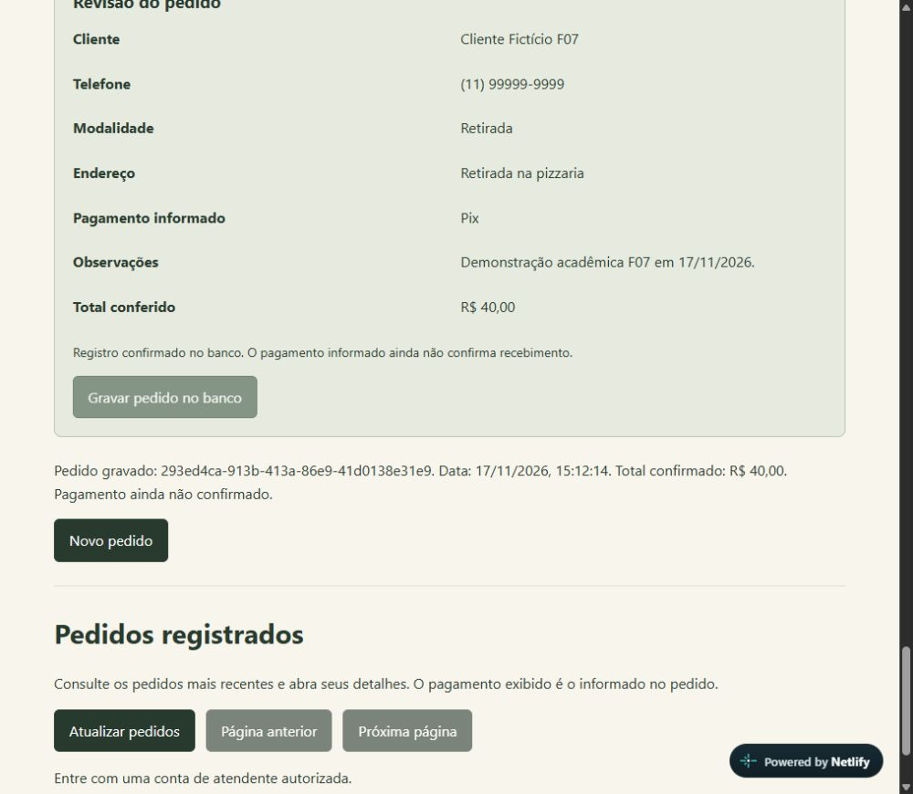
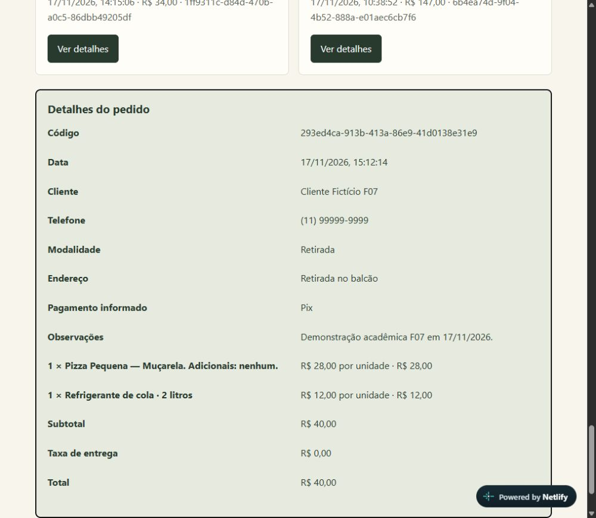

# Demonstração comentada do DINNOS

Material preparado a pedido de Samuel Quintão Rodrigues Santiago para a
disciplina de Estágio Supervisionado. Demonstração técnica delegada ao agente;
não representa execução ou explicação oral realizada pelo aluno.

## Exemplo demonstrado

Na verificação de 17/11/2026, o sistema publicado registrou um pedido com cliente
fictício, retirada e Pix informado. Foram incluídos uma pizza pequena de muçarela
de R$ 28,00 e um refrigerante de cola de 2 litros de R$ 12,00. O total foi R$ 40,00,
sem taxa de entrega.

O código confirmado foi `293ed4ca-913b-413a-86e9-41d0138e31e9`, com data
17/11/2026 às 15:12:14, conforme exibida pela aplicação. A demonstração abaixo
documenta essa execução verificada; não afirma que um novo pedido foi criado agora.

## 1 Do preenchimento ao rascunho

**Mostrar:** formulário de montagem, produtos e resumo de valores.

**Fala sugerida:** “O DINNOS permite organizar o pedido antes de registrá-lo.
Informamos os dados do cliente e escolhemos retirada ou entrega. Neste exemplo,
selecionamos retirada e adicionamos uma pizza e uma bebida. O sistema calculou
R$ 28,00 mais R$ 12,00, totalizando R$ 40,00.”

O HTML define os campos; o CSS cuida da apresentação; o TypeScript reage às ações,
valida os dados e calcula os valores. Nessa etapa, o pedido existe como rascunho
na memória do navegador. Recarregar a página pode apagá-lo.

## 2 Da revisão ao envio

**Mostrar:** revisão dos dados e botão “Gravar pedido no banco”.

**Fala sugerida:** “A revisão permite conferir os dados antes de salvar. O sistema
verifica os campos obrigatórios e só prepara o envio quando o pedido é válido.
O rascunho revisado ainda não é um pedido gravado.”

Ao gravar, a aplicação prepara o código único da tentativa, os dados, os itens e
o total previsto, em centavos. O SDK oficial do Supabase envia a solicitação ao
serviço remoto por HTTPS. A tela fica aguardando a confirmação.

## 3 Do serviço remoto ao PostgreSQL

**Fala sugerida:** “O banco não aceita simplesmente o valor calculado na tela.
Ele confere se a conta está autorizada, verifica os dados e calcula novamente o
pedido usando seu catálogo. Se estiver correto, grava o pedido completo.”

A função `registrar_pedido` verifica a autorização e as regras e compara o total
calculado com o previsto. O PostgreSQL grava os dados em uma transação: uma falha
impede a gravação parcial. Descrições e preços ficam preservados no registro,
junto ao código, à data e ao atendente.

## 4 Da confirmação ao navegador



**Fala sugerida:** “Agora temos a confirmação do banco. A tela mostra o código,
a data e o total de R$ 40,00. É essa resposta que confirma o registro. A indicação
de Pix informa a forma de pagamento escolhida, mas não comprova o recebimento.”

O navegador verifica a consistência da resposta antes de apresentar sucesso.
O pedido confirmado fica bloqueado para evitar reenvio acidental. O botão
“Novo pedido” inicia outro rascunho. Repetir o mesmo código e conteúdo retorna
o original, sem criar uma duplicação.

## 5 Da consulta ao retorno dos dados



**Fala sugerida:** “Depois de recarregar a página, atualizamos a lista e abrimos
os detalhes. O mesmo pedido reapareceu com seu código, data, pizza, bebida e
total de R$ 40,00. Isso demonstra que o registro foi recuperado do banco.”

Na consulta, o SDK solicita os registros ao Supabase. As políticas de acesso
permitem a leitura para atendentes autorizados. O banco retorna os dados salvos;
o TypeScript os verifica e apresenta os detalhes na página. A consulta utiliza
os preços históricos do pedido, sem recalcular a partir do cardápio atual.

## 6 Resumo para apresentar

```text
Preenchimento na tela
  -> validação e cálculo do rascunho no navegador
  -> revisão e solicitação pelo SDK do Supabase
  -> autorização e validação no servidor
  -> cálculo e gravação transacional no PostgreSQL
  -> confirmação com código, data e total na tela

Atualizar pedidos ou consultar código
  -> solicitação pelo SDK
  -> verificação das políticas de acesso
  -> leitura do pedido persistido
  -> retorno dos dados e apresentação dos detalhes
```

**Encerramento sugerido:** “O navegador é responsável pela interação; o Supabase
fornece autenticação e acesso ao banco; o PostgreSQL preserva os pedidos. A tela
só confirma a gravação depois da resposta do servidor. Em uma falha de rede,
consultamos o código antes de iniciar outro pedido para evitar duplicação.”

## Limites da demonstração

O exemplo usa preços e dados fictícios. Não comprova implantação diária na empresa
ou redução medida de custos e erros. Não há confirmação de pagamento, controle
de estoque ou acompanhamento de produção e entrega. O sistema depende de internet
para gravar e consultar. O teste em dois dispositivos e a falha física de rede
permanecem nas evidências relatadas pelo autor na F05; não foram repetidos neste
material. A explicação oral e o domínio do conteúdo pelo aluno não foram avaliados.
