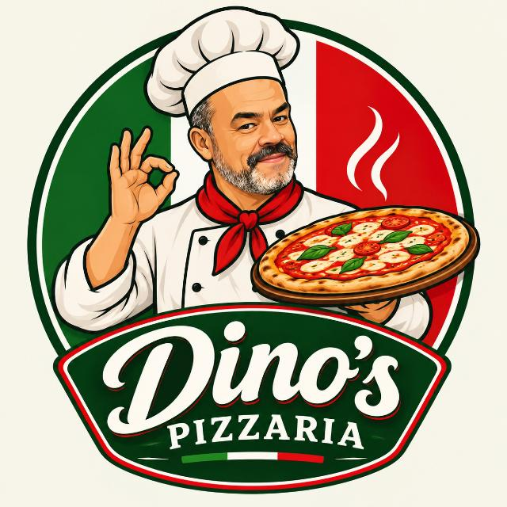
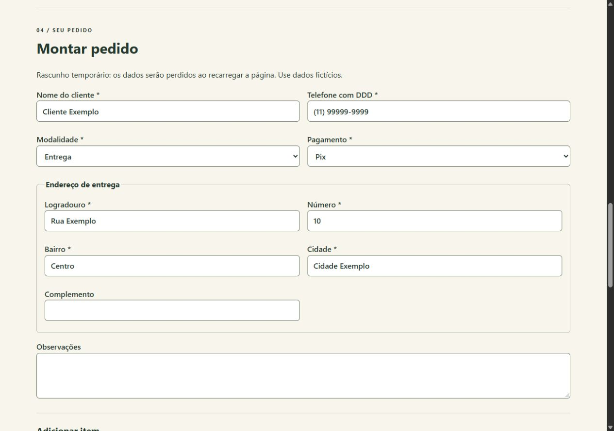
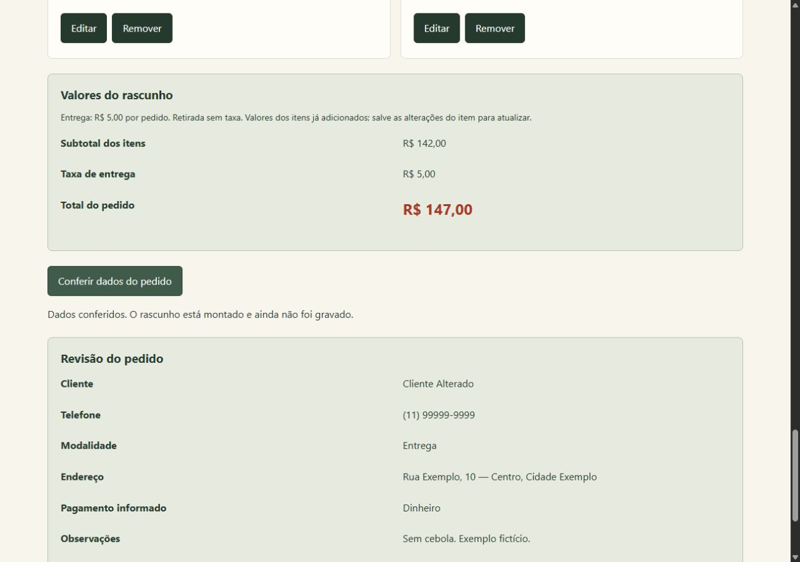
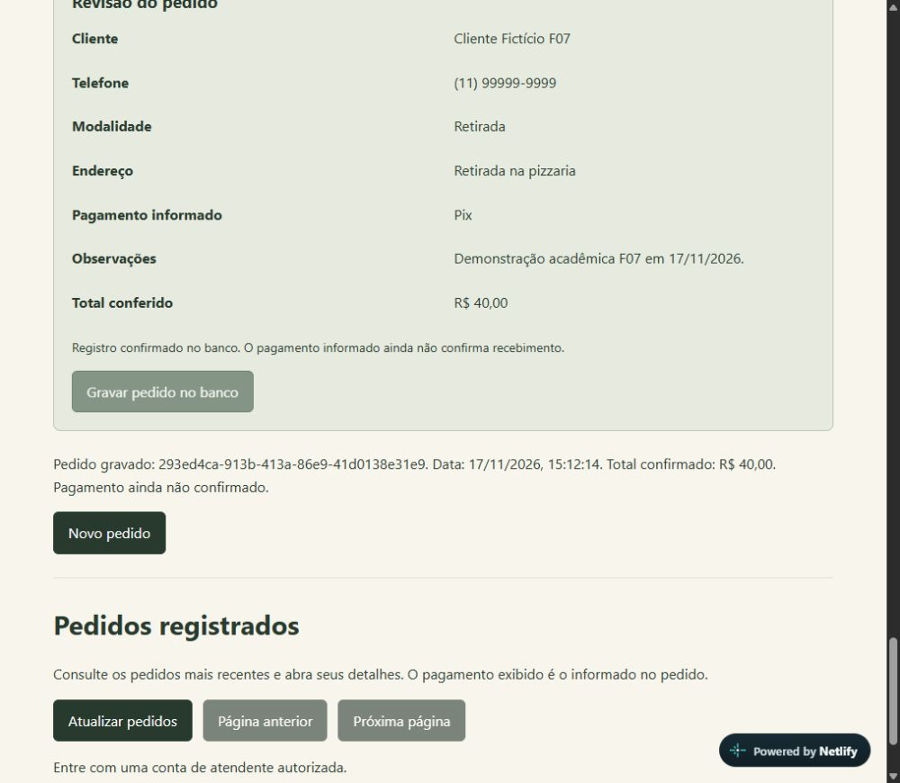
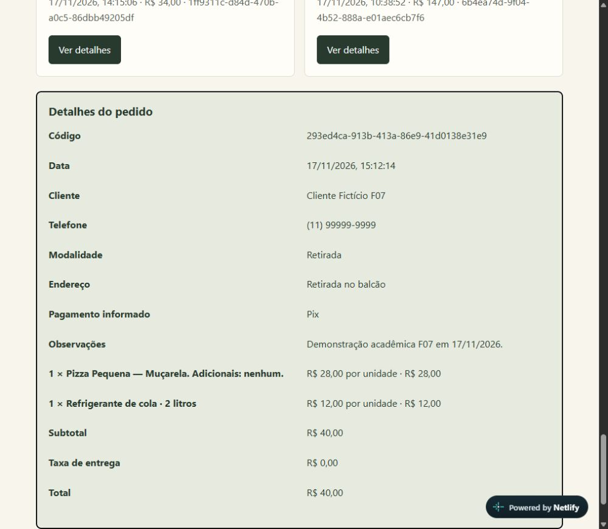
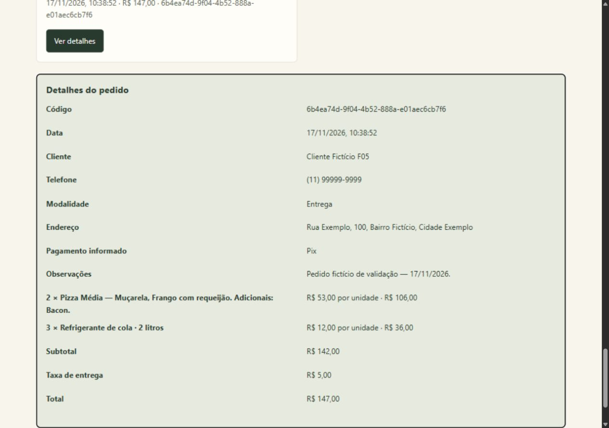
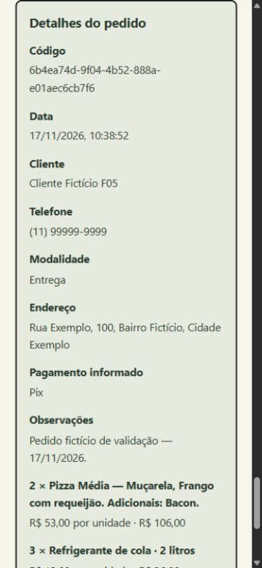

# DINNOS aplicação web para registro e consulta de pedidos da Dino’s Pizzaria

Autor: Samuel Quintão Rodrigues Santiago.

Disciplina: Estágio Supervisionado.

**Minuta em elaboração.** Esta versão organiza o conteúdo pelo roteiro de ADS
fornecido pelo autor. Não constitui documento pronto para entrega: faltam dados
acadêmicos, complementação do levantamento e revisão da formatação institucional.



## 1. Apresentação da empresa

A empresa escolhida para o estudo é a Dinos, cuja identidade visual apresenta o
nome Dino’s Pizzaria. Segundo informações fornecidas pelo autor em 17 de novembro
de 2026, trata-se de uma empresa familiar de pequeno porte, na qual trabalham
marido e esposa. O estabelecimento está localizado na cidade de Serra, na
localidade informada como “Cidade Continal, Setor Ásia”. A grafia dessa localização
e sua correspondência com o local de origem solicitado pelo manual serão conferidas.

A área de atuação considerada neste projeto é a comercialização de pizzas e o
atendimento a pedidos. O autor informou que os registros são feitos em papel.
O porte mencionado corresponde à descrição fornecida, sem afirmar enquadramento
jurídico ou tributário. Não foram informados faturamento ou data de fundação.

## 2. Definição do projeto

O projeto consiste em uma aplicação web para registrar e consultar pedidos.
O nome técnico DINNOS identifica o sistema desenvolvido para o estudo da
Dino’s Pizzaria. A proposta parte do processo de anotação em papel relatado pelo
autor e oferece uma alternativa de registro estruturado em banco de dados.

A escolha de uma aplicação web permite acessar a interface pelo navegador em
computador e celular. Na versão desenvolvida, a consulta compartilhada depende de
conexão com a internet e de uma conta de atendente autorizada. Essa escolha foi
verificada tecnicamente no protótipo; a disponibilidade de internet e a adequação
à rotina dos responsáveis ainda precisam ser confirmadas com a empresa.

O levantamento disponível comprova apenas, por relato do autor, o uso do papel.
Não permite concluir que a empresa deixa de utilizar qualquer software em outras
atividades. Também não permite afirmar que ocorrem perdas de pedidos, cobranças
incorretas ou atrasos. A descrição detalhada do fluxo atual e das dificuldades
observadas será acrescentada após sua confirmação.

## 3. Descrição da aplicação

O objetivo geral é oferecer uma alternativa digital para organizar o registro e a
consulta dos pedidos. Os objetivos específicos são apresentar um cardápio,
estruturar a montagem, conferir campos obrigatórios, calcular valores e preservar
os pedidos confirmados para consulta posterior.

O atendente consulta o cardápio, informa os dados do cliente, escolhe entrega ou
retirada e adiciona os itens. Nas pizzas, seleciona tamanho, sabores e adicionais.
O sistema apresenta o resumo e permite revisar o rascunho antes da gravação.
Após a confirmação do banco, o pedido recebe código e data e fica disponível
para consulta por código ou na lista de pedidos registrados.

Os requisitos funcionais implementados incluem montagem e edição de itens do
rascunho, cálculo de valores, revisão, autenticação, gravação compartilhada e
consulta de detalhes. As verificações incluem pedido vazio, telefone, endereço
obrigatório para entrega, quantidades e limites de sabores. Os requisitos de uso
contemplam interface adaptada a telas pequenas e operação por teclado.

Os valores são representados em centavos. Na combinação de sabores, o cálculo
usa o sabor mais caro no tamanho; adicionais são cobrados por unidade de pizza.
A entrega de demonstração acrescenta R$ 5,00 por pedido. Essas regras, produtos e
preços são fictícios e não representam o cardápio confirmado da empresa.

O protótipo não controla estoque, produção, entregas, caixa ou recebimento de
pagamentos. A forma de pagamento é apenas informada. Pedidos confirmados não
podem ser editados ou excluídos pela interface. Rascunhos ficam em memória e
podem ser perdidos ao recarregar. A aplicação ainda não foi caracterizada como
implantada na operação diária da empresa.

## 4. Tecnologias

HTML estrutura o conteúdo e os formulários; CSS define a apresentação e o layout
adaptável (MDN WEB DOCS, s.d.a; s.d.b). No projeto são empregados HTML5 e CSS3
autoral. TypeScript organiza as regras, os eventos e os tipos de dados, sendo
transformado em JavaScript para execução no navegador (TYPESCRIPT, s.d.). Não
foi utilizado framework de interface, Bootstrap ou SASS.

O Vite executa a prévia de desenvolvimento e gera os arquivos de publicação.
Node.js e npm são ferramentas de desenvolvimento, compilação e testes.
O Netlify hospeda os arquivos estáticos resultantes.

O Supabase fornece autenticação e banco PostgreSQL. A integração usa o SDK
oficial. O projeto combina autenticação com uma lista de atendentes ativos e
políticas de acesso por linha, recurso documentado pelo Supabase (SUPABASE,
s.d.). Uma pessoa autenticada precisa também estar autorizada para consultar ou
gravar pedidos. A chave pública utilizada pelo navegador não concede acesso
privilegiado ao banco.

Na gravação, a aplicação envia os dados, os itens, o código da tentativa e o total
previsto. A função do banco verifica o acesso, valida a solicitação e calcula os
valores a partir do catálogo interno. A transação preserva descrições e preços
daquele registro. A interface só apresenta sucesso após receber a confirmação.
Repetir o mesmo código com o mesmo conteúdo não cria outro pedido.

O fluxo pode ser resumido assim:

```text
Atendente autorizado
  -> formulário e montagem no navegador
  -> validação e cálculo do rascunho
  -> revisão e envio pelo SDK
  -> autorização, validação e cálculo no PostgreSQL
  -> confirmação com código, data e total
  -> listagem e detalhes do pedido salvo
```

No banco, `pedidos.atendente` referencia `auth.users.id`.
`atendentes_autorizados.identificador` também referencia `auth.users.id`.
O catálogo fica no esquema interno. Os dados do cliente e os itens são armazenados
no registro do pedido em campos JSONB; não existem tabelas independentes de
clientes e itens nesta implementação.

## 5. Proposta de valor

A proposta oferece aos responsáveis uma forma estruturada de registrar pedidos
e recuperar suas informações em dispositivos autorizados. A revisão antes da
gravação e a apresentação dos valores podem apoiar a conferência durante o
atendimento. O histórico preserva os preços registrados mesmo que o catálogo seja
alterado posteriormente.

Essas características representam benefícios esperados, coerentes com o escopo
desenvolvido. Não há medição de redução de custos, tempo ou erros, nem pesquisa
de satisfação na empresa. A avaliação desses resultados dependerá de uso
acompanhado e comparação com o processo atual. A adoção também deverá considerar
conexão com a internet, treinamento e manutenção do catálogo.

## 6. Apresentação da aplicação desenvolvida

A demonstração está disponível em
[DINNOS](https://eloquent-pie-d5c729.netlify.app/).
Para uso local, instalar Node.js 22.12 ou superior, executar `npm ci` e configurar
o ambiente conforme `banco/README.md`. Executar `npm run dev` e abrir a URL
informada pelo Vite. A senha do atendente não deve integrar o relatório.

### 6.1 Tutorial de operação

1. Abrir a página e consultar pizzas, tamanhos, bebidas e adicionais.
2. Entrar em “Acesso do atendente” com uma conta autorizada.
3. Informar dados fictícios, modalidade e pagamento. Para entrega, preencher endereço.
4. Adicionar pizza e bebida; conferir os limites de sabores, quantidades e valores.
5. Revisar o pedido e gravar. Guardar código, data e total confirmados pelo banco.
6. Abrir “Consultar pedidos registrados”, atualizar e selecionar “Ver detalhes”.
7. Conferir cliente, itens, observações, pagamento informado, taxa e total.
8. Sair e verificar a remoção dos dados da tela.

### 6.2 Telas e evidências disponíveis



Figura 1 - Formulário com dados fictícios e endereço condicionado à entrega.
Fonte: captura de validação da etapa de montagem, 2026.



Figura 2 - Cálculo do rascunho e revisão antes da gravação.
Fonte: captura de validação da etapa de cálculo, 2026.



Figura 3 - Pedido fictício final confirmado pelo banco, com código, data e total
de R$ 40,00. Fonte: verificação final na aplicação publicada, 2026.



Figura 4 - Consulta posterior do mesmo registro, com retirada, itens e valores
preservados. Fonte: verificação final na aplicação publicada, 2026.



Figura 5 - Detalhes do pedido fictício, incluindo itens, pagamento informado e
valores preservados. Fonte: captura da aplicação durante validação técnica, 2026.



Figura 6 - Apresentação dos detalhes em largura de celular. Fonte: captura da
aplicação durante validação técnica, 2026. Esta imagem é uma verificação de layout;
o teste em dois dispositivos físicos foi relatado separadamente pelo autor.

As figuras de montagem e revisão documentam etapas anteriores do mesmo projeto;
as figuras 3 e 4 documentam a verificação final da versão publicada. As telas usam
dados fictícios; não representam pedidos comerciais comprovados da pizzaria.

### 6.3 Verificações e limitações

Na última execução registrada, `npm test` aprovou checagem de tipos, compilação e
32 testes. Os testes abrangem cálculos, validações, gravação, políticas de acesso,
persistência e comportamento das consultas. A consulta autenticada foi verificada
na prévia conectada ao Supabase real. Foram conferidos três pedidos e os detalhes
de um registro fictício de R$ 147,00, além da limpeza ao sair e do acesso negado
sem autenticação. As capturas foram produzidas em larguras de 390 e 1280 pixels,
sem rolagem horizontal observada.

O autor relatou cinco cenários com resultado esperado: gravação, reabertura do
navegador, consulta no celular, acesso negado e falha de rede sem falso sucesso.
Esse relato é distinto dos testes executados pelo agente de desenvolvimento.
Não foi exercitada a navegação em um histórico com mais de 20 pedidos.

Na verificação final da F07, a aplicação publicada recebeu um pedido fictício de
retirada: uma pizza pequena de muçarela por R$ 28,00 e uma cola por R$ 12,00,
totalizando R$ 40,00, com Pix informado. O banco confirmou o código
`293ed4ca-913b-413a-86e9-41d0138e31e9`, em 17/11/2026 às 15:12:14.
Após recarregar a página, a listagem apresentou quatro pedidos e os detalhes
preservaram esse código, a data, os itens e o total. O pedido vazio foi bloqueado
pelos campos obrigatórios e não foram observados erros no console. Essa execução
foi feita pelo agente de desenvolvimento; a demonstração e a explicação pelo autor
são atividades separadas, orientadas em `roteiro-demonstracao.md`.

## Referências

Referências técnicas consultadas para esta minuta, em ordem alfabética.
O recorte do manual solicita NBR 6023 e menciona ABNT, 2002. A edição e a
formatação de entrega devem ser conferidas conforme orientação da instituição.

MDN WEB DOCS. **CSS**. [S. l.], [s. d.a]. Disponível em:
https://developer.mozilla.org/pt-BR/docs/Web/CSS. Acesso em: 17 nov. 2026.

MDN WEB DOCS. **HTML: Linguagem de Marcação de Hipertexto**. [S. l.], [s. d.b].
Disponível em: https://developer.mozilla.org/pt-BR/docs/Web/HTML.
Acesso em: 17 nov. 2026.

MULTIVIX. **Manual de estágio supervisionado: cursos tecnológicos EAD**.
[S. l.], [s. d.]. p. 40-43. Recorte fornecido pelo autor como
“EXIGÊNCIAS DO TRABALHO ADS.pdf”. Dados editoriais a completar a partir do manual integral.

SUPABASE. **Row Level Security**. [S. l.], [s. d.]. Disponível em:
https://supabase.com/docs/guides/database/postgres/row-level-security.
Acesso em: 17 nov. 2026.

TYPESCRIPT. **TypeScript Documentation**. [S. l.], [s. d.]. Disponível em:
https://www.typescriptlang.org/docs/. Acesso em: 17 nov. 2026.

## Anexos

Logo fornecida pelo autor e preservada no início desta minuta. Para comprovar os
processos levantados, ainda são necessários documentos autorizados da empresa,
como modelo de anotação em branco ou relato dos responsáveis. Não foram recebidos
contratos, entrevistas, registros de vendas ou documentos de implantação.
As capturas do protótipo comprovam sua apresentação, não a adoção pela empresa.
